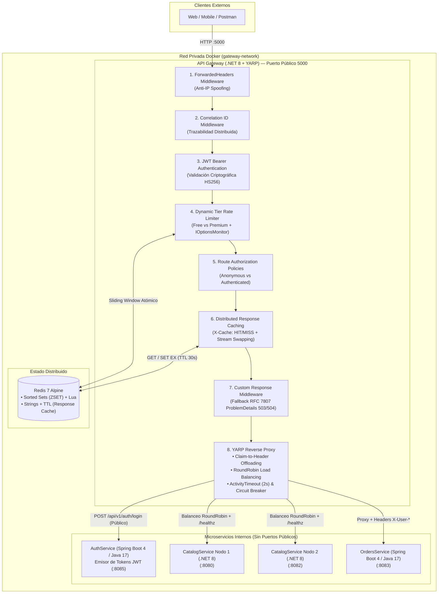

# 🚀 Enterprise Polyglot API Gateway (.NET 8, YARP, Spring Boot & Redis)

Una arquitectura de **API Gateway Cloud-Native** de alto rendimiento construida con **ASP.NET Core (.NET 8)** y **Microsoft YARP**, diseñada para orquestar, proteger y escalar un ecosistema de microservicios políglota (**.NET 8** y **Java 17 / Spring Boot**) utilizando **Redis** para control de tráfico distribuido y **Docker Compose** para aislamiento de red.

---

## 🏛️ Arquitectura del Sistema



---

## ✨ Características de Nivel Producción Implementadas

### 1. Seguridad Centralizada y *JWT Gateway Offloading*
* **Separación Emisor / Validador:** Un microservicio dedicado en **Java Spring Boot (`AuthService`)** autentica credenciales y firma tokens JWT (`HS256`) con `sub`, `username`, `role`, `tier`, `iss`, `aud` y `exp`.
* **Validación en el Borde (Edge Authentication):** El API Gateway valida criptográficamente el token con `ClockSkew = TimeSpan.Zero` y `MapInboundClaims = false`. Las peticiones no autorizadas son rechazadas con `401 Unauthorized` en el Gateway sin consumir recursos de los microservicios internos.
* **Prevención de *Header Spoofing* e Inyección de Contexto:** Mediante `RequestTransforms` de YARP, el Gateway elimina cualquier cabecera `X-User-*` maliciosa proveniente del exterior e inyecta los claims validados (`X-User-Id`, `X-User-Name`, `X-User-Role`, `X-User-Tier`) hacia los microservicios downstream.

### 2. Rate Limiting Distribuido Dinámico por *Tier* (`Free` vs `Premium`)
* **Algoritmo *Sliding Window Counter* en Redis con Lua:** Ejecución atómica en un único *round-trip* de red (`ZREMRANGEBYSCORE` + `ZCARD` + `ZADD` + `EXPIRE`), eliminando condiciones de carrera (*race conditions*) entre múltiples instancias del Gateway.
* **Cuotas Dinámicas Basadas en Claims:**
  * Usuarios autenticados se particionan en Redis por identidad (`ratelimit:sliding:user:{sub}`) y reciben la cuota correspondiente a su claim `tier` (`Free`: 5 req/10s, `Premium`: 10+ req/10s).
  * Usuarios anónimos (ej. `/auth/login`) se particionan por IP (`ratelimit:sliding:ip:{ip}`) bajo el `DefaultTier`, protegiendo el servicio de autenticación contra ataques de fuerza bruta.
* **Recarga en Caliente (`IOptionsMonitor`) y Resiliencia (*Fail-Open*):** Las cuotas por Tier pueden ajustarse en `appsettings.json` en tiempo real sin reiniciar el Gateway. Si Redis experimenta una caída transitoria, el Gateway degrada elegantemente permitiendo el paso del tráfico.

### 3. Alta Disponibilidad, Balanceo de Carga y Health Checks Híbridos
* **Escalado Horizontal:** `CatalogService` opera en un clúster de múltiples réplicas balanceadas mediante política **`RoundRobin`**.
* **Active + Passive Health Checks en YARP:**
  * **Sondeo Activo (`ConsecutiveFailures`):** YARP verifica proactivamente el endpoint `/healthz` de cada contenedor (.NET y Spring Boot) cada 10 segundos. Si una réplica cae, se retira automáticamente del clúster.
  * **Sondeo Pasivo (`TransportFailureRate`):** Monitorea la tasa de fallos de transporte en el tráfico real para aislar nodos degradados entre intervalos de sondeo activo y reactivarlos tras su periodo de enfriamiento (`ReactivationPeriod`).

### 4. Observabilidad y Trazabilidad Distribuida Políglota
* **Propagación de `X-Correlation-Id` de Extremo a Extremo:** El Gateway genera o preserva el identificador de correlación en cada solicitud y lo propaga a todos los microservicios.
* **Logging Estructurado Homogéneo:** Implementado mediante `ILogger.BeginScope` con `IncludeScopes` en **.NET 8** y `OncePerRequestFilter` + `SLF4J MDC` (`logback-spring.xml`) en **Java Spring Boot**, permitiendo rastrear una transacción completa a través de distintos lenguajes de programación.

### 5. Response Caching Distribuido en el Borde (`X-Cache: HIT` / `MISS`)
* **Cortocircuito en Memoria RAM con Redis:** Para rutas de alta lectura configurables (ej. `GET /catalog/products`), el Gateway consulta Redis antes de reenviar la solicitud a los microservicios downstream.
* **Reducción Drástica de Latencia (`X-Cache: HIT`):** Si la respuesta existe en Redis dentro de la ventana de vida (`DefaultTtlSeconds: 30`), el Gateway responde directamente desde la RAM con el `Content-Type` y `Body` originales sin golpear los contenedores de `CatalogService` ni sus bases de datos.
* **Intercepción Transparente de Streams (`X-Cache: MISS`):** Si la clave no existe, el middleware intercepta el stream de respuesta de YARP mediante *MemoryStream Swapping*, almacena el payload en Redis con expiración automática (`SET key value EX ttl`) únicamente cuando el microservicio responde `200 OK`, y devuelve los bytes al cliente con resiliencia *Fail-Open*.

### 6. Resiliencia Avanzada: Timeouts, Circuit Breaker por Nodo y *Fallback* (`ProblemDetails`)
* **Corte por Tiempo de Espera (`ActivityTimeout: 00:00:02`):** Ninguna petición hacia los microservicios downstream puede quedarse bloqueada más de **2 segundos** esperando una base de datos colapsada. Si supera el umbral, YARP cancela el socket inmediatamente y devuelve `504 Gateway Timeout`.
* **Circuit Breaker Nativo por Instancia (`Passive Health Check` + `HealthyAndUnknown`):**
  * Configurado mediante `TransportFailureRateHealthPolicyOptions` (`DetectionWindowSize: 30s`, `MinimalTotalCountThreshold: 5`, `FailureRateLimit: 0.3`).
  * Si un nodo acumula 5 timeouts/fallos dentro de la ventana de 30 segundos, YARP **abre el cortocircuito** exclusivamente para esa instancia durante 30 segundos (`ReactivationPeriod: 00:00:30`).
  * En clústeres sin nodos sanos disponibles (`AvailableDestinationsPolicy: HealthyAndUnknown`), el Gateway rechaza las llamadas en **$0\text{ ms}$** con `503 Service Unavailable` sin tocar la red, pasando a estado *Half-Open* (`Unknown`) automáticamente tras los 30s de enfriamiento.
* **Respuestas Amigables Estandarizadas (`CustomResponseMiddleware`):** Intercepta los estados `503 Service Unavailable` y `504 Gateway Timeout` para devolver un payload estructurado bajo el estándar **RFC 7807 (`application/problem+json`)** sin contaminar el caché de Redis.

---

## 🛠️ Stack Tecnológico

| Capa | Tecnología | Rol en la Arquitectura |
| :--- | :--- | :--- |
| **API Gateway** | .NET 8 (C# 12), Microsoft YARP 2.3 | Enrutamiento inverso, Auth Offloading, Caché, Balanceo, Health Checks |
| **Estado Distribuido** | Redis 7 Alpine, StackExchange.Redis, Lua | Ventanas deslizantes (Rate Limit) y Response Caching distribuido con TTL |
| **Identidad (`AuthService`)** | Java 17, Spring Boot 4, JJWT (`0.13.0`) | Autenticación y emisión de tokens JWT firmados (`HS256`) |
| **Catálogo (`CatalogService`)** | .NET 8 Minimal APIs (2 Réplicas) | Microservicio de productos con soporte de alta disponibilidad |
| **Órdenes (`OrdersService`)** | Java 17, Spring Boot 4, Lombok | Microservicio de pedidos protegido por políticas del Gateway |
| **Infraestructura** | Docker & Docker Compose | Contenerización multi-stage y aislamiento en red privada |

---

## 📂 Estructura del Repositorio

```text
ApiGateway/
├── docker-compose.yml              # Orquestación de Redis, Gateway y 4 contenedores de microservicios
├── requests.http                   # Suite de pruebas HTTP listas para ejecutar
├── README.md                       # Documentación general
├── Notes.md                        # Bitácora personal de arquitectura y lecciones aprendidas
└── src/
    ├── Gateway/
    │   └── ApiGateway/             # API Gateway (.NET 8 + YARP)
    │       ├── Configuration/      # Opciones tipadas (RateLimitingOptions, ResponseCachingOptions)
    │       ├── Middlewares/        # CorrelationId, RateLimiting, ResponseCaching y CustomResponse (Fallback)
    │       ├── Services/           # RedisRateLimiterService y RedisResponseCachedService
    │       ├── Program.cs          # Pipeline de seguridad, Resiliencia, Caché y Transforms de YARP
    │       └── appsettings.json    # Rutas, Clusters, Timeouts, Circuit Breaker, Caché y Tiers de Rate Limit
    └── Services/
        ├── AuthService/            # Microservicio Emisor de JWT (Java 17 / Spring Boot)
        ├── CatalogService/         # Microservicio de Catálogo (.NET 8 - Escalado a 2 nodos)
        └── OrdersService/          # Microservicio de Órdenes (Java 17 / Spring Boot)
```

---

## 🚀 Cómo Ejecutar el Proyecto

### Prerrequisitos
* [Docker Desktop](https://www.docker.com/products/docker-desktop/) activo.

### 1. Levantar toda la infraestructura
Desde la raíz del repositorio:

```bash
docker compose up -d --build
```

| Contenedor | Tecnología | Puerto | Acceso |
| :--- | :--- | :--- | :--- |
| `apigateway-proxy` | .NET 8 + YARP | **`5000:8080`** | **Público** (`http://localhost:5000`) |
| `apigateway-redis` | Redis 7 Alpine | `6379:6379` | Almacén de estado |
| `apigateway-auth-service` | Spring Boot | `8085` | Privado (Solo vía Gateway `/api/v1/auth/*`) |
| `apigateway-catalog-service` | .NET 8 (Nodo 1) | `8080` | Privado (Solo vía Gateway `/api/v1/catalog/*`) |
| `apigateway-catalog-service-2` | .NET 8 (Nodo 2) | `8082` | Privado (Solo vía Gateway `/api/v1/catalog/*`) |
| `apigateway-orders-service` | Spring Boot | `8083` | Privado (Solo vía Gateway `/api/v1/orders/*`) |

---

## 🧪 Guía de Pruebas Rápidas

### 1. Verificar protección de rutas (`401 Unauthorized`)
```bash
curl -i http://localhost:5000/api/v1/orders
```
*El Gateway bloquea la petición inmediatamente al no incluir un JWT válido.*

### 2. Obtener un Token JWT (`Free` vs `Premium`)
* **Usuario `Premium` (`Juan` / `hash1`):**
  ```bash
  curl -i -X POST http://localhost:5000/api/v1/auth/login \
    -H "Content-Type: application/json" \
    -d '{"username":"Juan","password":"hash1"}'
  ```
* **Usuario `Free` (`Maria` / `hash2`):**
  ```bash
  curl -i -X POST http://localhost:5000/api/v1/auth/login \
    -H "Content-Type: application/json" \
    -d '{"username":"Maria","password":"hash2"}'
  ```

### 3. Consumir microservicios protegidos y verificar Rate Limiting por Tier
```bash
curl -i http://localhost:5000/api/v1/orders \
  -H "Authorization: Bearer <TU_JWT_TOKEN>"
```
Observa los encabezados de respuesta inyectados por el Gateway:
* `X-Correlation-Id`: ID único propagado hasta los logs de Java/.NET.
* `X-RateLimit-Limit`: `10` (si usaste el token de `Juan` - `Premium`) o `5` (si usaste el de `Maria` - `Free`).
* `X-RateLimit-Remaining`: Peticiones disponibles en la ventana deslizante de 10 segundos.

### 4. Probar Response Caching Distribuido (`X-Cache: MISS` vs `HIT`)
Realiza dos peticiones seguidas en menos de 30 segundos al catálogo:
```bash
curl -i http://localhost:5000/api/v1/catalog/products \
  -H "Authorization: Bearer <TU_JWT_TOKEN>"
```
* **1ra Petición:** Devuelve `X-Cache: MISS` (YARP consulta a `CatalogService` y almacena la respuesta en Redis por 30s).
* **2da Petición (dentro de los 30s):** Devuelve `X-Cache: HIT` directamente desde la memoria de Redis en menos de 2ms sin tocar los contenedores del microservicio.

### 5. Probar Failover Automático (Health Checks de YARP)
Detén una de las réplicas de catálogo:
```bash
docker stop apigateway-catalog-service-2
```
Realiza múltiples peticiones a `GET http://localhost:5000/api/v1/catalog/products` con tu token: YARP detecta la caída mediante `/healthz` y redirige el $100\%$ del tráfico hacia el nodo sano sin errores `502` para el cliente.

### 6. Probar Timeout (`504`) y Cortocircuito / Circuit Breaker (`503`)
El endpoint `GET /api/v1/orders` incluye un retraso simulado por defecto de `5000ms` (configurable con `?delay=0` para respuestas rápidas):
```bash
curl -i http://localhost:5000/api/v1/orders \
  -H "Authorization: Bearer <TU_JWT_TOKEN_PREMIUM>"
```
* **Peticiones 1 a 5 (Circuito Cerrado):** Como el servicio tarda 5s y el `ActivityTimeout` del Gateway es de **2s**, YARP corta la espera a los 2 segundos y devuelve **`504 Gateway Timeout`** con formato `application/problem+json`.
* **Petición 6 en adelante (Circuito Abierto):** Al alcanzar el umbral (`MinimalTotalCountThreshold: 5`), YARP abre el circuito por 30 segundos (`ReactivationPeriod: 00:00:30`) y responde en **$0\text{ ms}$** con **`503 Service Unavailable`** (`ProblemDetails`).
* **Auto-Recuperación (*Half-Open* $\rightarrow$ *Closed*):** Pasados 30 segundos, llama a `GET http://localhost:5000/api/v1/orders?delay=0` para comprobar cómo YARP reactiva el nodo automáticamente y devuelve `200 OK`.

---

## 📄 Licencia
Distribuido bajo la licencia MIT.
