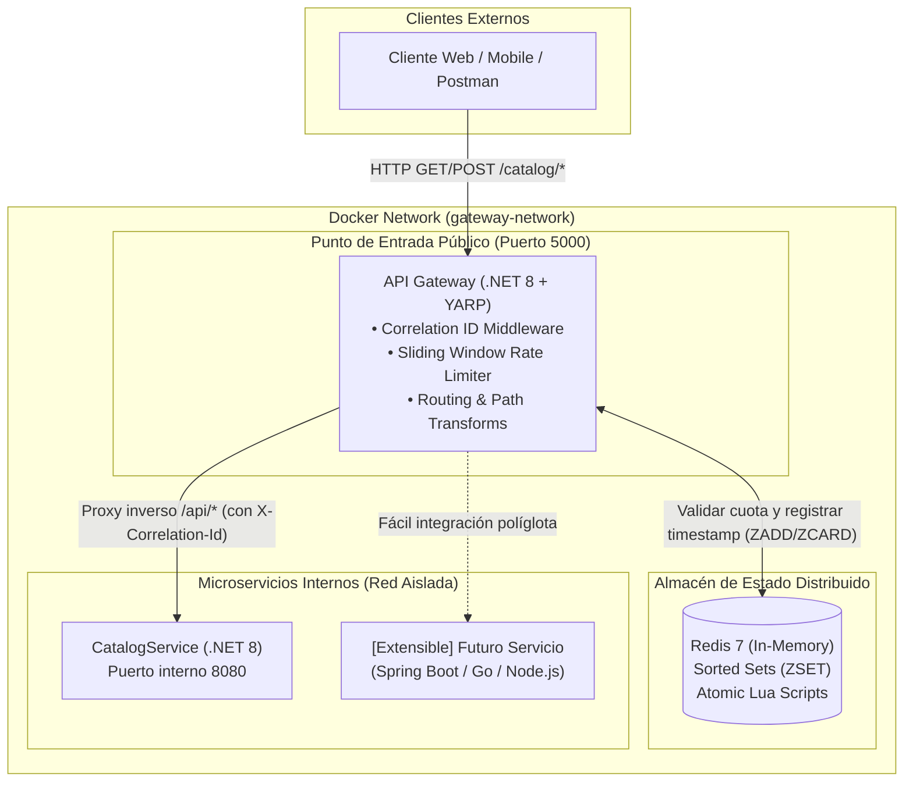

# 🚀 Enterprise API Gateway con YARP, Redis y .NET 8

Una solución moderna, resiliente y de alto rendimiento de **API Gateway** construida con **ASP.NET Core (.NET 8 LTS)** y **YARP (Yet Another Reverse Proxy)** de Microsoft, complementada con un mecanismo de **Rate Limiting Distribuido (Sliding Window Counter)** implementado en **Redis** mediante scripts Lua atómicos, y orquestada con **Docker Compose**.

Diseñada para servir como punto de entrada unificado y seguro en arquitecturas de microservicios políglotas.

---

## 🏛️ Diagrama de Arquitectura



---

## ✨ Características Principales

- **Reverse Proxy con Microsoft YARP 2.x**: Enrutamiento declarativo de alta eficiencia, transformación de rutas (`/catalog/{path}` $\rightarrow$ `/api/{path}`) y balanceo de carga.
- **Rate Limiting Distribuido con Sliding Window Counter**:
  - Implementado sobre **Redis** usando colecciones ordenadas (**Sorted Sets / `ZSET`**) y scripts **Lua atómicos**.
  - Evita el problema clásico de saturación en los bordes de tiempo del algoritmo *Fixed Window*.
  - Inyecta cabeceras estándar de la industria: `X-RateLimit-Limit`, `X-RateLimit-Remaining` y `Retry-After` con respuesta `429 Too Many Requests` (RFC 6585).
  - Estrategia **Fail-Open**: Si Redis no responde temporalmente, el tráfico de los usuarios no se interrumpe.
- **Trazabilidad y Observabilidad**:
  - Generación y propagación automática de `X-Correlation-Id` en todo el ciclo de vida de la petición.
  - Logging estructurado con `BeginScope` para auditoría y rastreo distribuido.
- **Arquitectura Políglota Agnóstica**:
  - El Gateway opera sobre protocolos estándar HTTP/REST y gRPC.
  - Puedes añadir servicios construidos en **Java / Spring Boot**, Python, Go o Node.js simplemente declarando el contenedor en `docker-compose.yml` y una regla en `appsettings.json`, sin modificar el código del Gateway.
- **Contenedores y Aislamiento de Red**:
  - `Dockerfile` multi-stage optimizado para producción.
  - Los microservicios de backend no exponen puertos al host exterior; permanecen protegidos dentro de la red privada de Docker.

---

## 🧠 ¿Cómo funciona el Sliding Window Counter en Redis?

A diferencia de un contador simple (*Fixed Window*), el algoritmo de ventana deslizante mantiene un registro de cada solicitud entrante dentro de un rango de tiempo móvil.

```text
Ventana Móvil: Últimos 10 Segundos
|----------------------------------------------------|
[Sol. 1]     [Sol. 2]     [Sol. 3]    [Sol. 4]    [Sol. 5]   --> [Intento 6: BLOQUEADO (429)]
t-9s         t-7s         t-4s        t-2s        t-0s
```

1. **`ZREMRANGEBYSCORE`**: Elimina de Redis todas las peticiones con marca de tiempo anterior a `(ahora - ventana)`.
2. **`ZCARD`**: Cuenta el número de solicitudes en la ventana móvil actual.
3. Si `conteo < límite`:
   - Agrega la solicitud actual con **`ZADD`** usando el timestamp Unix en milisegundos como score.
   - Aplica **`EXPIRE`** automático a la clave para liberar memoria.
   - Permite que la petición continúe con código `200 OK`.
4. Si `conteo >= límite`:
   - Calcula exactamente cuántos segundos faltan para que la solicitud más antigua expire.
   - Devuelve `429 Too Many Requests` con el encabezado `Retry-After: {segundos}`.

Todo este proceso se ejecuta en **un único viaje de red (Round-Trip)** mediante un script Lua, garantizando atomicidad sin condiciones de carrera (*Race Conditions*).

---

## 📂 Estructura del Proyecto

```text
ApiGateway/
├── ApiGateway.sln                  # Solución .NET compatible
├── ApiGateway.slnx                 # Solución moderna .NET 10
├── docker-compose.yml              # Orquestación de Redis, Gateway y Microservicios
├── requests.http                   # Suite de pruebas interactivas (REST Client / VS)
├── README.md                       # Documentación
└── src/
    ├── Gateway/
    │   └── ApiGateway/             # API Gateway (YARP + Redis + Middlewares)
    │       ├── Middlewares/
    │       │   ├── CorrelationIdMiddleware.cs
    │       │   └── DistributedRateLimitingMiddleware.cs
    │       ├── Services/
    │       │   └── RedisRateLimiterService.cs
    │       ├── Configuration/
    │       │   └── RateLimitingOptions.cs
    │       ├── Dockerfile
    │       ├── Program.cs
    │       └── appsettings.json
    └── Services/
        └── CatalogService/         # Microservicio Backend de Ejemplo
            ├── Models/
            │   └── Product.cs
            ├── Dockerfile
            ├── Program.cs
            └── appsettings.json
```

---

## 🚀 Despliegue Rápido (Docker Compose)

### Prerrequisitos
- [Docker Desktop](https://www.docker.com/products/docker-desktop/) instalado y en ejecución.

### Ejecución con un solo comando:
En la raíz del proyecto, ejecuta:

```bash
docker compose up --build -d
```

Verifica el estado de los contenedores:
```bash
docker compose ps
```

| Contenedor | Imagen | Puerto Expuesto | Función |
| :--- | :--- | :--- | :--- |
| `apigateway-proxy` | `api-gateway:latest` | `5000:8080` | Punto de entrada público (YARP Gateway) |
| `apigateway-redis` | `redis:7-alpine` | `6379:6379` | Almacén de contadores de tráfico |
| `apigateway-catalog-service` | `catalog-service:latest` | Interno (`8080`) | Microservicio downstream protegido |

Para detener el entorno:
```bash
docker compose down
```

---

## 🧪 Pruebas y Validación

Puedes utilizar el archivo [requests.http](file:///C:/Sources/Personal-Proyects/ApiGateway/requests.http) directamente desde Visual Studio Code o Visual Studio, o ejecutar los siguientes comandos con `curl`:

### 1. Verificar Estado del Gateway
```bash
curl -i http://localhost:5000/healthz
```

### 2. Consultar Productos a través del Gateway
```bash
curl -i http://localhost:5000/catalog/products
```
*Observa en los encabezados:*
- `X-Correlation-Id: <uuid>` (Trazabilidad)
- `X-RateLimit-Limit: 5`
- `X-RateLimit-Remaining: 4`

### 3. Probar el Rate Limiting (Disparo de HTTP 429)
Ejecuta 6 peticiones consecutivas rápidamente:
```bash
for i in {1..6}; do curl -i http://localhost:5000/catalog/products; echo ""; done
```
*En la 6ta petición obtendrás:*
```http
HTTP/1.1 429 Too Many Requests
Content-Type: application/problem+json
Retry-After: 9
X-RateLimit-Limit: 5
X-RateLimit-Remaining: 0

{
  "type": "https://tools.ietf.org/html/rfc6585#section-4",
  "title": "Too Many Requests",
  "status": 429,
  "detail": "Has excedido el límite de solicitudes (5 peticiones por cada 10 segundos). Por favor intenta de nuevo en 9 segundos.",
  "instance": "/catalog/products"
}
```

---

## 🔮 Cómo integrar un Microservicio en Spring Boot (Políglota)

Para demostrar cómo esta arquitectura se integra con tecnologías no .NET (como **Java / Spring Boot**):

1. Agrega el servicio en `docker-compose.yml`:
   ```yaml
   orders-service:
     image: orders-service:latest
     build:
       context: ./src/Services/OrdersService # Tu proyecto Spring Boot
     networks:
       - gateway-network
   ```
2. Agrega la ruta en `src/Gateway/ApiGateway/appsettings.json`:
   ```json
   "orders-route": {
     "ClusterId": "orders-cluster",
     "Match": { "Path": "/orders/{**catch-all}" },
     "Transforms": [{ "PathPattern": "/api/{**catch-all}" }]
   }
   ```
3. Agrega el clúster:
   ```json
   "orders-cluster": {
     "Destinations": {
       "orders-node": { "Address": "http://orders-service:8080" }
     }
   }
   ```
¡El Gateway enrutará, aplicará el Rate Limiting con Redis y propagará el Correlation ID al servicio de Spring Boot de manera transparente!

---

## 📄 Licencia
Este proyecto es de código abierto bajo la licencia MIT.
