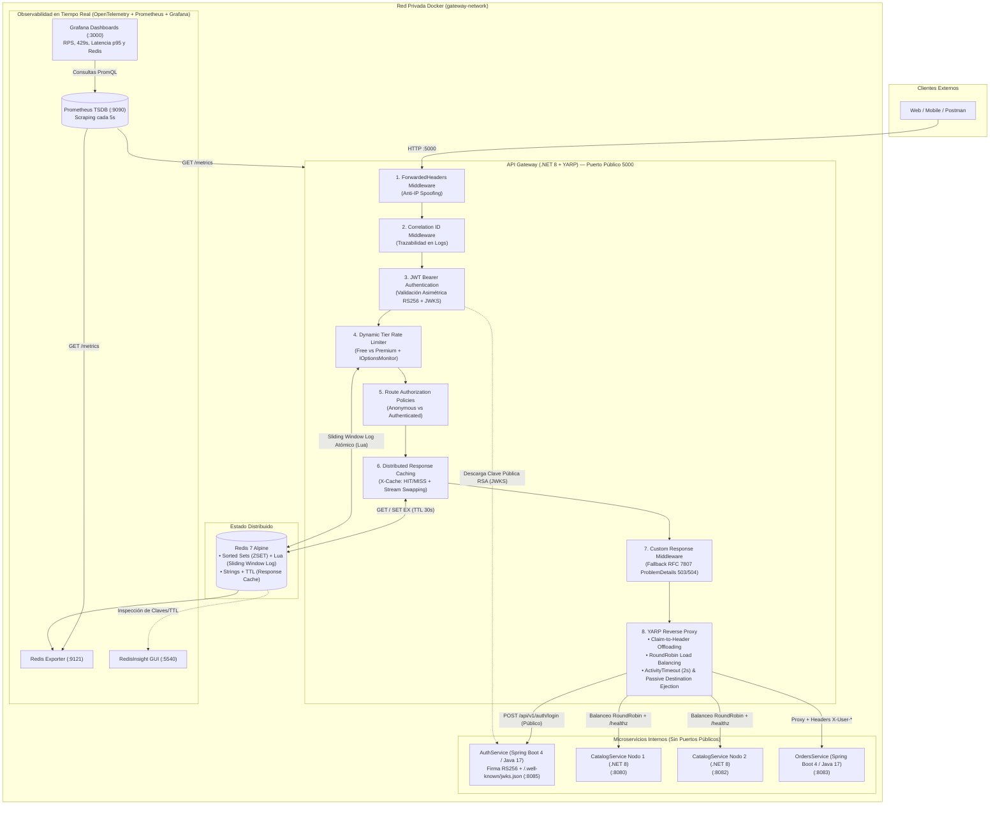
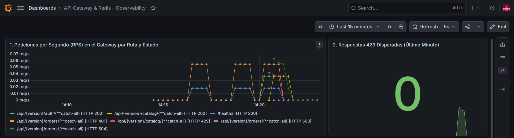
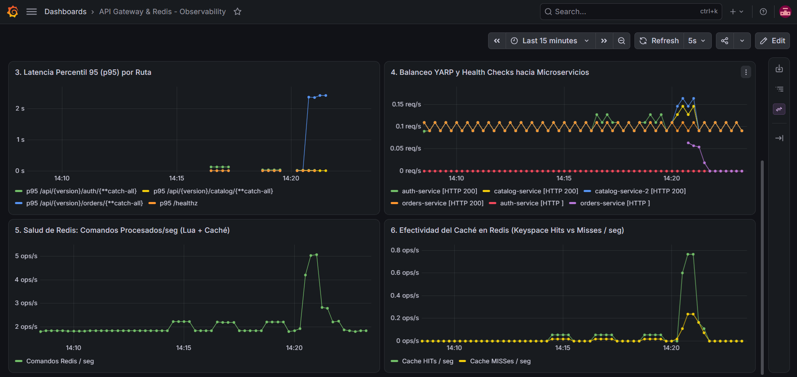
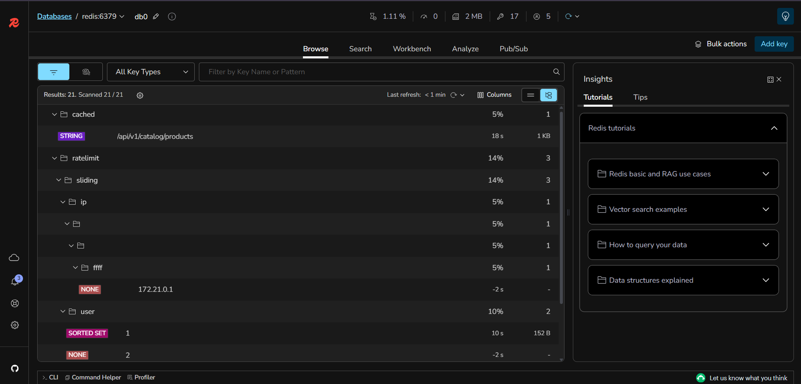
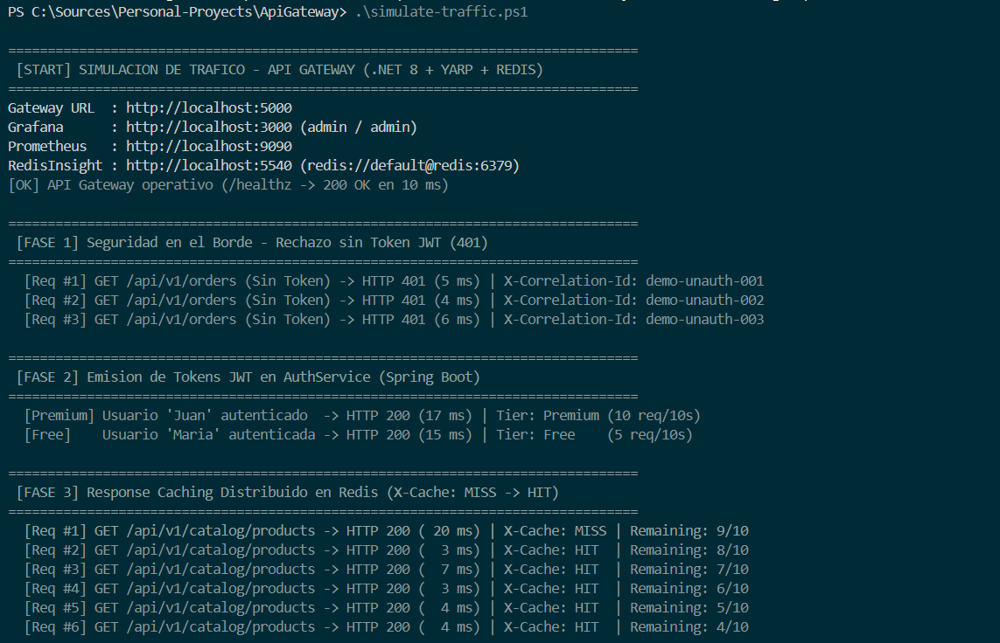

# 🚀 Cloud-Native Polyglot API Gateway (.NET 8, YARP, Spring Boot & Redis)

Una arquitectura de **API Gateway Cloud-Native** construida con **ASP.NET Core (.NET 8)** y **Microsoft YARP**, diseñada aplicando patrones inspirados en entornos de producción para orquestar, proteger y observar un ecosistema de microservicios políglota (**.NET 8** y **Java 17 / Spring Boot**) utilizando **Redis** para control de tráfico distribuido y **Docker Compose** para aislamiento de red.

---

## 🏛️ Arquitectura del Sistema



---

## ✨ Características y Patrones Inspirados en Producción

### 1. Seguridad Centralizada Asimétrica (*JWT Gateway Offloading* con `RS256` + `JWKS`)
* **Firma Asimétrica (`RSA-2048` / `RS256`) y Estándar RFC 7517 (`JWKS`):** El microservicio **`AuthService` (Java Spring Boot)** conserva en privado la clave RSA de firma y expone únicamente su clave pública en `GET /api/v1/authentication/.well-known/jwks.json` (`kty`, `kid`, `n`, `e`). El API Gateway **no comparte ningún secreto simétrico** con el servicio de identidad.
* **Validación en el Borde con Caché de Claves Públicas (`JwksKeyResolverService`):** El API Gateway descarga bajo demanda el conjunto de claves públicas `JWKS`, lo mantiene en memoria RAM para validar cada petición en microsegundos (`ClockSkew = TimeSpan.Zero`, `MapInboundClaims = false`) y soporta rotación automática de claves si detecta un `kid` nuevo.
* **Prevención de *Header Spoofing* e Inyección de Contexto:** Mediante `RequestTransforms` de YARP, el Gateway elimina cualquier cabecera `X-User-*` maliciosa proveniente del exterior e inyecta los claims validados (`X-User-Id`, `X-User-Name`, `X-User-Role`, `X-User-Tier`) hacia los microservicios downstream.

### 2. Rate Limiting Distribuido Dinámico por *Tier* (`Free` vs `Premium`)
* **Algoritmo *Sliding Window Log* en Redis con Lua y Reloj Monotónico (`TIME`):** Ejecución atómica en un único *round-trip* de red (`TIME` + `ZREMRANGEBYSCORE` + `ZCARD` + `ZADD` + `EXPIRE`). Al utilizar el reloj interno de Redis (`redis.call('TIME')`) y miembros únicos (`timestamp:UUID`), evita desfases de reloj (*clock skew*) entre múltiples réplicas del Gateway y colisiones en peticiones dentro del mismo milisegundo.
* **Cuotas Dinámicas Basadas en Claims:**
  * Usuarios autenticados se particionan en Redis por identidad (`ratelimit:sliding:user:{sub}`) y reciben la cuota correspondiente a su claim `tier` (`Free`: 5 req/10s, `Premium`: 10+ req/10s).
  * Usuarios anónimos (ej. `/auth/login`) se particionan por IP (`ratelimit:sliding:ip:{ip}`) bajo el `DefaultTier`, protegiendo el servicio de autenticación contra ataques de fuerza bruta.
* **Recarga en Caliente (`IOptionsMonitor`) y Resiliencia (*Fail-Open*):** Las cuotas por Tier pueden ajustarse en `appsettings.json` en tiempo real sin reiniciar el Gateway. Si Redis experimenta una caída transitoria, el Gateway degrada elegantemente permitiendo el paso del tráfico.

### 3. Alta Disponibilidad, Balanceo de Carga y Health Checks Híbridos
* **Escalado Horizontal:** `CatalogService` opera en un clúster de múltiples réplicas balanceadas mediante política **`RoundRobin`**.
* **Active + Passive Health Checks en YARP:**
  * **Sondeo Activo (`ConsecutiveFailures`):** YARP verifica proactivamente el endpoint `/healthz` de cada contenedor (.NET y Spring Boot) cada 10 segundos. Si una réplica cae, se retira automáticamente del clúster.
  * **Sondeo Pasivo (`TransportFailureRate`):** Monitorea la tasa de fallos de transporte en el tráfico real para aislar nodos degradados entre intervalos de sondeo activo y reactivarlos tras su periodo de enfriamiento (`ReactivationPeriod`).

### 4. Correlación de Logs Políglota (`.NET 8` $\leftrightarrow$ `Spring Boot`)
* **Propagación de `X-Correlation-Id` de Extremo a Extremo:** El Gateway genera o preserva el identificador de correlación en cada solicitud y lo propaga a todos los microservicios.
* **Logging Estructurado Homogéneo:** Implementado mediante `ILogger.BeginScope` con `IncludeScopes` en **.NET 8** y `OncePerRequestFilter` + `SLF4J MDC` (`logback-spring.xml`) en **Java Spring Boot**, permitiendo rastrear los logs de una transacción a través de distintos lenguajes.

### 5. Response Caching Distribuido en el Borde (`X-Cache: HIT` / `MISS`)
* **Aislamiento de Rutas Públicas y `QueryString`:** El caché en el borde se restringe exclusivamente a rutas de lectura compartidas (`/api/v1/catalog/products`), excluyendo endpoints con datos privados por usuario (`/api/v1/orders`). La clave en Redis incorpora la ruta y el `QueryString` normalizado (`cached:/api/v1/catalog/products?category=computers`) para evitar colisiones entre filtros.
* **Reducción de Latencia (`X-Cache: HIT`):** Si la respuesta existe en Redis dentro de la ventana de vida (`DefaultTtlSeconds: 30`), el Gateway responde directamente desde la RAM con el `Content-Type` y `Body` originales sin golpear los contenedores de `CatalogService`.
* **Intercepción Transparente de Streams (`X-Cache: MISS`):** Si la clave no existe, el middleware intercepta el stream de respuesta de YARP mediante *MemoryStream Swapping*, almacena el payload en Redis con expiración automática (`SET key value EX ttl`) únicamente cuando el microservicio responde `200 OK`, y devuelve los bytes al cliente con resiliencia *Fail-Open*.

### 6. Resiliencia Avanzada: Timeout de Inactividad, Expulsión Pasiva de Destinos (*Outlier Detection*) y *Fallback* (`ProblemDetails`)
* **Corte por Inactividad de Transporte (`ActivityTimeout: 00:00:02`):** Limita el tiempo máximo de inactividad en el stream HTTP esperando cabeceras o bytes desde los microservicios downstream a **2 segundos**. Si un servicio bloqueado no responde dentro de ese umbral, YARP aborta el socket y devuelve `504 Gateway Timeout`.
* **Expulsión Reactiva de Nodos con *Passive Health Checks* (`TransportFailureRate` + `HealthyAndUnknown`):**
  * Configurado mediante `TransportFailureRateHealthPolicyOptions` (`DetectionWindowSize: 30s`, `MinimalTotalCountThreshold: 5`, `FailureRateLimit: 0.3`).
  * Si un nodo acumula 5 timeouts/fallos de transporte dentro de la ventana de 30 segundos, YARP lo marca como `Unhealthy` y lo expulsa temporalmente del balanceo durante 30 segundos (`ReactivationPeriod: 00:00:30`), logrando un comportamiento equivalente a un *Circuit Breaker* por destino (patrón *Outlier Detection*).
  * En clústeres sin nodos sanos disponibles (`AvailableDestinationsPolicy: HealthyAndUnknown`), el Gateway hace cortocircuito inmediato (`503 Service Unavailable`) sin abrir conexiones de red hacia el microservicio, y vuelve a evaluar el destino (`Unknown`) automáticamente tras los 30s de enfriamiento.
* **Respuestas Amigables Estandarizadas (`CustomResponseMiddleware`):** Intercepta los estados `503 Service Unavailable` y `504 Gateway Timeout` para devolver un payload estructurado bajo el estándar **RFC 7807 (`application/problem+json`)** sin contaminar el caché de Redis.

### 7. Observabilidad del Gateway y Redis (OpenTelemetry, Prometheus, Grafana y RedisInsight)
* **Instrumentación con OpenTelemetry (.NET 8):** El API Gateway expone `/metrics` utilizando `OpenTelemetry.Exporter.Prometheus.AspNetCore`, capturando métricas de Kestrel, el pipeline HTTP de ASP.NET Core (`http_server_request_duration_seconds`) y las conexiones salientes de YARP (`http_client_request_duration_seconds`).
* **Recolección de Series Temporales con Prometheus (`:9090`):** Hace *scraping* cada 5 segundos al API Gateway (`api-gateway:8080/metrics`) y al contenedor `redis-exporter:9121` sin ser bloqueado por el Rate Limiter.
* **Dashboards Provisionados como Código en Grafana (`:3000`):** Incluye aprovisionamiento automático (*Configuration as Code* en `monitoring/grafana/`) para conectar Prometheus y cargar de serie el tablero **`API Gateway & Redis - Observability`** con:
  * **Peticiones por Segundo (RPS)** desglosadas por ruta y código de estado HTTP.
  * **Bloqueos del Rate Limiter (`429 Too Many Requests`)** en tiempo real.
  * **Latencia Percentil 95 (`p95`)** calculada con `histogram_quantile(0.95, ...)`.
  * **Balanceo de Carga de YARP y Sondeos de Salud (`/healthz`)** hacia los microservicios downstream.
  * **Telemetría Operativa de Redis** (comandos/seg del script Lua y *Cache Hit vs Miss Ratio*) complementada con **RedisInsight (`:5540`)** para inspección visual de claves y TTLs en desarrollo.

---

## 🛠️ Stack Tecnológico

| Capa | Tecnología | Rol en la Arquitectura |
| :--- | :--- | :--- |
| **API Gateway** | .NET 8 (C# 12), Microsoft YARP 2.3 | Enrutamiento inverso, Auth Offloading (`RS256`/JWKS), Caché, Balanceo, Health Checks |
| **Estado Distribuido** | Redis 7 Alpine, StackExchange.Redis, Lua | *Sliding Window Log* (Rate Limit) y Response Caching distribuido con TTL |
| **Observabilidad** | OpenTelemetry, Prometheus, Grafana, Redis Exporter, RedisInsight | Telemetría del Gateway y Redis (RPS, 429s, latencia p95, salud de Redis e inspección de llaves) |
| **Identidad (`AuthService`)** | Java 17, Spring Boot 4, JJWT (`0.13.0`) | Emisión de tokens JWT firmados con clave privada RSA (`RS256`) y exposición de `/.well-known/jwks.json` |
| **Catálogo (`CatalogService`)** | .NET 8 Minimal APIs (2 Réplicas) | Microservicio de productos con soporte de alta disponibilidad |
| **Órdenes (`OrdersService`)** | Java 17, Spring Boot 4, Lombok | Microservicio de pedidos protegido por políticas del Gateway |
| **Infraestructura** | Docker & Docker Compose | Contenerización multi-stage y aislamiento en red privada |

---

## 📂 Estructura del Repositorio

```text
ApiGateway/
├── docker-compose.yml              # Orquestación de Gateway, Redis, Microservicios y Stack de Observabilidad
├── prometheus.yml                  # Configuración de scraping de Prometheus (Gateway + Redis Exporter)
├── monitoring/
│   └── grafana/                    # Dashboards y DataSources provisionados como código (Zero-Click)
├── docs/
│   └── images/                     # Capturas reproducibles de Grafana, RedisInsight y Simulación
├── simulate-traffic.ps1            # Simulador automatizado de escenarios de tráfico (401, HIT/MISS, 429, 504, 503)
├── requests.http                   # Suite de pruebas HTTP interactivas listas para ejecutar (VS Code / Rider)
├── README.md                       # Documentación general
└── src/
    ├── Gateway/
    │   └── ApiGateway/             # API Gateway (.NET 8 + YARP + OpenTelemetry)
    │       ├── Configuration/      # Opciones tipadas (RateLimitingOptions, ResponseCachingOptions)
    │       ├── Middlewares/        # CorrelationId, RateLimiting, ResponseCaching y CustomResponse (Fallback)
    │       ├── Services/           # RedisRateLimiterService y RedisResponseCachedService
    │       ├── Program.cs          # Pipeline de seguridad, Resiliencia, Caché, OpenTelemetry y Transforms de YARP
    │       └── appsettings.json    # Rutas, Clusters, Timeouts, Health Checks Pasivos, Caché y Tiers de Rate Limit
    └── Services/
        ├── AuthService/            # Microservicio Emisor de JWT (Java 17 / Spring Boot)
        ├── CatalogService/         # Microservicio de Catálogo (.NET 8 - Escalado a 2 nodos)
        └── OrdersService/          # Microservicio de Órdenes (Java 17 / Spring Boot)
```

---

## 📸 Galería de Observabilidad en Vivo (100% Reproducible)

> 💡 **¿Quieres reproducir exactamente estas métricas y gráficas en tu máquina?**
> Tras levantar los contenedores con `docker compose up -d`, ejecuta **`.\simulate-traffic.ps1 -Continuous`** en PowerShell. El script ejecutará automáticamente todos los escenarios de prueba (autenticación JWT, caché `MISS` $\rightarrow$ `HIT`, bloqueos `429` por Rate Limit, timeouts `504` y expulsión pasiva de destinos `503`) poblando Grafana y RedisInsight en tiempo real.

### 1. Tráfico por Ruta, Códigos de Estado (`200`, `401`, `429`, `503`, `504`) y Bloqueos de Rate Limit (`http://localhost:3000`)


### 2. Latencia `p95`, Balanceo `RoundRobin` en YARP y Efectividad del Caché en Redis (`HIT` vs `MISS`)


### 3. Inspección de Estructuras Atómicas (`SORTED SET`) y Caché (`STRING`) en RedisInsight (`http://localhost:5540`)
*Visualización jerárquica en tiempo real del payload cacheado (`cached:/api/v1/catalog/products` con TTL de 30s) y los registros de ventana deslizante (*Sliding Window Log*) por usuario/IP (`ratelimit:sliding:*` con TTL de 10s).*


### 4. Simulación Automatizada de Escenarios (`simulate-traffic.ps1` en entorno Docker local)
*Mediciones funcionales en entorno local: rechazo en el borde (`401` en `~4ms`), emisión de JWT en Spring Boot y reducción de latencia de `~20ms` (`X-Cache: MISS`) a `~3ms` (`X-Cache: HIT`).*


---

## 🚀 Cómo Ejecutar el Proyecto

### Prerrequisitos
* [Docker Desktop](https://www.docker.com/products/docker-desktop/) activo.

### 1. Levantar toda la infraestructura
Desde la raíz del repositorio:

```bash
docker compose up -d --build
```

| Contenedor | Tecnología | Puerto | Acceso |
| :--- | :--- | :--- | :--- |
| `apigateway-proxy` | .NET 8 + YARP + OTel | **`5000:8080`** | **Público** (`http://localhost:5000`) |
| `apigateway-grafana` | Grafana | **`3000:3000`** | **Dashboard Visual** (`http://localhost:3000` — `admin` / `admin`) |
| `apigateway-prometheus` | Prometheus TSDB | **`9090:9090`** | **Consola PromQL / Targets** (`http://localhost:9090`) |
| `apigateway-redis-insight` | RedisInsight GUI | **`5540:5540`** | **Visor de Llaves Redis** (`http://localhost:5540` — URL: `redis://default@redis:6379`) |
| `apigateway-redis` | Redis 7 Alpine | `6379:6379` | Almacén de estado en memoria |
| `apigateway-redis-exporter` | Redis Exporter | `9121` | Privado (Métricas operativas de Redis hacia Prometheus) |
| `apigateway-auth-service` | Spring Boot | `8085` | Privado (Solo vía Gateway `/api/v1/auth/*`) |
| `apigateway-catalog-service` | .NET 8 (Nodo 1) | `8080` | Privado (Solo vía Gateway `/api/v1/catalog/*`) |
| `apigateway-catalog-service-2` | .NET 8 (Nodo 2) | `8082` | Privado (Solo vía Gateway `/api/v1/catalog/*`) |
| `apigateway-orders-service` | Spring Boot | `8083` | Privado (Solo vía Gateway `/api/v1/orders/*`) |

### 2. Poblar métricas automáticamente (1 Comando)
Para ejecutar la coreografía completa de pruebas y alimentar las gráficas de Grafana y RedisInsight:

```powershell
# Ejecución única (~35 segundos)
.\simulate-traffic.ps1

# O en modo continuo (mantiene las llaves y TTLs activos en Redis mientras inspeccionas)
.\simulate-traffic.ps1 -Continuous
```

---

## 🧪 Guía de Pruebas Rápidas (Manuales o vía `requests.http`)

### 1. Verificar protección de rutas (`401 Unauthorized`)
```bash
curl -i http://localhost:5000/api/v1/orders
```
*El Gateway bloquea la petición inmediatamente al no incluir un JWT válido.*

### 2. Obtener un Token JWT (`Free` vs `Premium`)
* **Usuario `Premium` (`Juan` / `hash1`):**
  ```bash
  curl -i -X POST http://localhost:5000/api/v1/auth/login \
    -H "Content-Type: application/json" \
    -d '{"username":"Juan","password":"hash1"}'
  ```
* **Usuario `Free` (`Maria` / `hash2`):**
  ```bash
  curl -i -X POST http://localhost:5000/api/v1/auth/login \
    -H "Content-Type: application/json" \
    -d '{"username":"Maria","password":"hash2"}'
  ```

### 3. Consumir microservicios protegidos y verificar Rate Limiting por Tier
```bash
curl -i http://localhost:5000/api/v1/orders \
  -H "Authorization: Bearer <TU_JWT_TOKEN>"
```
Observa los encabezados de respuesta inyectados por el Gateway:
* `X-Correlation-Id`: ID único propagado hasta los logs de Java/.NET.
* `X-RateLimit-Limit`: `10` (si usaste el token de `Juan` - `Premium`) o `5` (si usaste el de `Maria` - `Free`).
* `X-RateLimit-Remaining`: Peticiones disponibles en la ventana deslizante de 10 segundos.

### 4. Probar Response Caching Distribuido (`X-Cache: MISS` vs `HIT`)
Realiza dos peticiones seguidas en menos de 30 segundos al catálogo:
```bash
curl -i http://localhost:5000/api/v1/catalog/products \
  -H "Authorization: Bearer <TU_JWT_TOKEN>"
```
* **1ra Petición:** Devuelve `X-Cache: MISS` (YARP consulta a `CatalogService` y almacena la respuesta en Redis por 30s).
* **2da Petición (dentro de los 30s):** Devuelve `X-Cache: HIT` directamente desde la memoria de Redis (`~3ms` en entorno Docker local) sin tocar los contenedores del microservicio.

### 5. Probar Failover Automático (Health Checks de YARP)
Detén una de las réplicas de catálogo:
```bash
docker stop apigateway-catalog-service-2
```
Realiza múltiples peticiones a `GET http://localhost:5000/api/v1/catalog/products` con tu token: YARP detecta la caída mediante `/healthz` y redirige el $100\%$ del tráfico hacia el nodo sano sin errores `502` para el cliente.

### 6. Probar Timeout de Inactividad (`504`) y Expulsión Pasiva de Destino (`503`)
El endpoint `GET /api/v1/orders` incluye un retraso simulado por defecto de `5000ms` (configurable con `?delay=0` para respuestas rápidas):
```bash
curl -i http://localhost:5000/api/v1/orders \
  -H "Authorization: Bearer <TU_JWT_TOKEN_PREMIUM>"
```
* **Peticiones 1 a 5 (Destino Activo):** Como el servicio tarda 5s sin enviar bytes y el `ActivityTimeout` del Gateway es de **2s**, YARP corta la espera a los 2 segundos y devuelve **`504 Gateway Timeout`** con formato `application/problem+json`.
* **Petición 6 en adelante (Destino Expulsado / Cortocircuito en el Gateway):** Al alcanzar el umbral de fallos (`MinimalTotalCountThreshold: 5`), el *Passive Health Check* de YARP marca el destino como `Unhealthy` durante 30 segundos (`ReactivationPeriod: 00:00:30`). Al no quedar destinos sanos (`HealthyAndUnknown`), el Gateway hace cortocircuito inmediato con **`503 Service Unavailable`** (`ProblemDetails`) sin abrir conexión de red hacia el microservicio.
* **Auto-Recuperación (`ReactivationPeriod`):** Pasados 30 segundos, el destino pasa a estado `Unknown` y vuelve a admitir tráfico; llama a `GET http://localhost:5000/api/v1/orders?delay=0` para comprobar cómo YARP lo confirma como `Healthy` y devuelve `200 OK`.

### 7. Observar Métricas en Tiempo Real en Grafana, Prometheus y RedisInsight
* **Grafana (`http://localhost:3000`):** Inicia sesión (`admin` / `admin`) y abre el Dashboard preconfigurado **`API Gateway & Redis - Observability`** para visualizar en vivo las Peticiones por Segundo (RPS), el contador de bloqueos `429`, el percentil `p95` de latencia, el balanceo `RoundRobin` de YARP y el ratio `HIT` vs `MISS` en Redis.
  * *Nota (Dashboards as Code):* El tablero se carga automáticamente desde `monitoring/grafana/dashboards/apigateway-observability.json` (formato de aprovisionamiento `v1`). Si realizas modificaciones visuales en Grafana y deseas actualizar el archivo del repositorio:
    ```powershell
    $headers = @{ Authorization = "Basic " + [Convert]::ToBase64String([Text.Encoding]::ASCII.GetBytes("admin:admin")) }
    (Invoke-RestMethod -Uri "http://localhost:3000/api/dashboards/uid/apigateway-redis-observability" -Headers $headers).dashboard | ConvertTo-Json -Depth 20 | Set-Content -Encoding UTF8 monitoring/grafana/dashboards/apigateway-observability.json
    ```
* **Prometheus (`http://localhost:9090/targets`):** Verifica que los jobs `api-gateway` (`http://api-gateway:8080/metrics`) y `redis-exporter` (`http://redis-exporter:9121/metrics`) estén en estado **`UP`**.
* **RedisInsight (`http://localhost:5540`):** Conéctate usando `redis://default@redis:6379` para inspeccionar en tiempo real las estructuras `ZSET` del Rate Limiter (`ratelimit:sliding:...`) y las claves `STRING` del Response Cache (`cached:/api/v1/...`) junto con la cuenta regresiva de sus TTLs.

---

## ⚖️ Decisiones de Diseño, Limitaciones Actuales y Roadmap

* ***Sliding Window Log* (`ZSET`) vs. *Sliding Window Counter* (`INCR`):** Se eligió *Sliding Window Log* con `redis.call('TIME')` y miembros únicos (`timestamp:UUID`) para garantizar exactitud matemática en los bordes de ventana sin *clock skew* entre instancias del Gateway, asumiendo un costo de memoria $O(N)$ por peticiones activas en la ventana de 10s.
* **Expulsión Pasiva en YARP vs. *Circuit Breaker* Clásico (Polly):** Se utilizaron los *Passive Health Checks* nativos de YARP (`TransportFailureRate` + `ReactivationPeriod`) para aislar réplicas degradadas individualmente (patrón *Outlier Detection*), junto con `ActivityTimeout` para cortar inactividad en el socket.
* **Próximas Iteraciones (Roadmap):**
  1. **Trazas Distribuidas (`W3C Traceparent`):** Exportación de *spans* con OpenTelemetry desde .NET 8 y Micrometer Tracing desde Spring Boot hacia **Grafana Tempo / Jaeger** para complementar el actual `X-Correlation-Id` en logs y las métricas del Gateway.
  2. **Tests de Integración y CI:** Suite automatizada con **xUnit + Testcontainers (Redis)** en **GitHub Actions** para validar concurrencia sobre el script Lua y la validación `RS256/JWKS`.
  3. **Benchmarking bajo Carga:** Pruebas de estrés con **`k6`** para medir `p95`/`p99` bajo concurrencia sostenida.

---

## 📄 Licencia
Distribuido bajo la licencia MIT.
